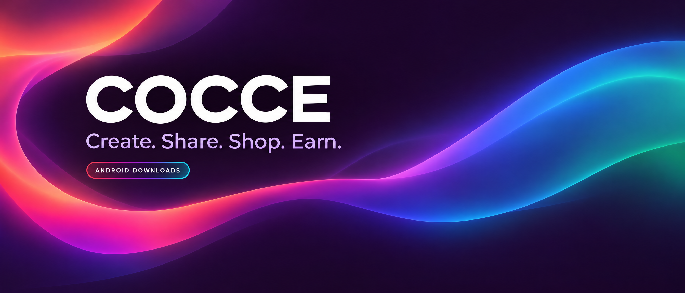

# COCCE for Android — version 1.0.29

Welcome! Choose **one** download for your Android phone or tablet. **Most newer phones use ARM64.** If you are not sure which file fits, choose **Universal**—it works across the supported phone types, but the download is larger.

## What’s new in this update

### A more comfortable tablet experience

COCCE now makes better use of a tablet’s larger screen. Feed controls are easier to use, Shop shortcuts are balanced across the screen, and the Welcome screen feels more at home on a tablet.

All existing app features and all 24 app languages remain included.

## Choose your download

| Build | Best for | Size | Download |
| --- | --- | ---: | --- |
| **ARM64** (`arm64-v8a`) | Most newer Android phones and tablets | 106.48 MiB | [Download ARM64](https://github.com/Hilpolith/COCCE-APP-RELEASES/releases/download/v1.0.29/cocce-1.0.29-arm64.apk) |
| **Universal** | If you are unsure which build fits your device | 236.98 MiB | [Download Universal](https://github.com/Hilpolith/COCCE-APP-RELEASES/releases/download/v1.0.29/cocce-1.0.29-universal.apk) |
| **ARMv7** (`armeabi-v7a`) | Older 32-bit ARM phones and tablets | 124.00 MiB | [Download ARMv7](https://github.com/Hilpolith/COCCE-APP-RELEASES/releases/download/v1.0.29/cocce-1.0.29-armv7.apk) |
| **x86_64** | Android emulators and some Intel-based devices | 101.39 MiB | [Download x86_64](https://github.com/Hilpolith/COCCE-APP-RELEASES/releases/download/v1.0.29/cocce-1.0.29-x86_64.apk) |

Android 7.0 or newer is required. After the download finishes, open the file and follow Android’s installation instructions. You can turn off the “install unknown apps” permission again after installing.

## Check your download

[SHA256SUMS.txt](SHA256SUMS.txt) lists the verified checksums for each 1.0.29 APK and keeps the earlier release checksums. More release details are in [RELEASE_NOTES.md](RELEASE_NOTES.md).

## Helpful links

[Open the COCCE download website](https://cocce-super-app-222ac.web.app/) · [See investor information](https://cocce.vercel.app/) · [Browse earlier releases](https://github.com/Hilpolith/COCCE-APP-RELEASES/releases)

### Share a COCCE link

Share a video, profile, shop or product from COCCE. People with the app can open the item there; everyone else can reach the download page. COCCE TV schedule links work the same way.

Optional: file checks and build details

The Android package is `com.cocce.cocce_super_app`; Android 7.0 or newer (SDK 24) is required. All four files are version `1.0.29`: ARM64 version code `6038`, Universal `4038`, ARMv7 `5038` and x86_64 `8038`.

All four APK signatures passed Android signature verification and use the certificate already published for COCCE App Links on the download site. They were built from app main commit [`cb03f84`](https://github.com/Hilpolith/COCCE_Super_App/commit/cb03f8495be61a9853ad88d1a16b02d0ace8e6f4). The focused layout and Shop regression tests passed (**18 tests**).

---

COCCE is owned and operated by HILPOLITH PHILLIP ROTHSCHILD. For COCCE support or privacy requests, email **coccesuperapp@gmail.com**. This public repository contains downloads and information, not the private app source code.
