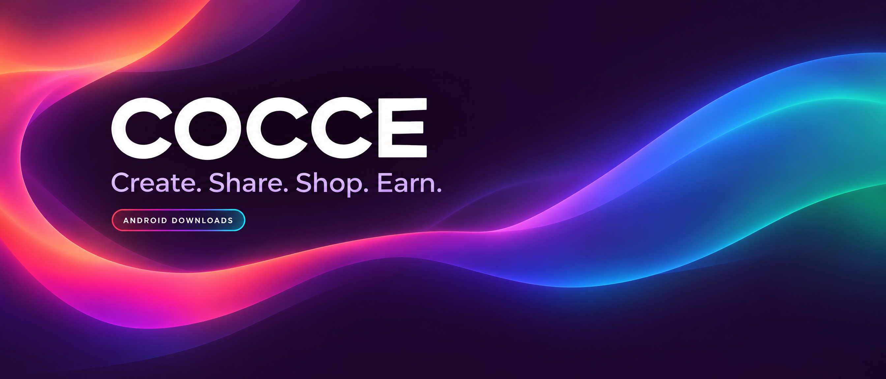

# COCCE for Android



[](https://github.com/Hilpolith/COCCE-APP-RELEASES/releases/tag/v1.0.26)
[](https://github.com/Hilpolith/COCCE-APP-RELEASES/releases/tag/v1.0.26)
[](https://cocce-super-app-222ac.web.app/)

Welcome! Choose **one** download for your Android device. **Not sure which one? Choose Universal.**

## 📲 Choose your download

| Build | Best for | Size | Download |
| --- | --- | ---: | --- |
| **ARM64** | Most newer Android phones | 106.42 MiB | [⬇️ Download ARM64](https://github.com/Hilpolith/COCCE-APP-RELEASES/releases/download/v1.0.26/cocce-1.0.26-arm64.apk) |
| **Universal** | If you’re not sure which build fits | 204.81 MiB | [🌈 Download Universal](https://github.com/Hilpolith/COCCE-APP-RELEASES/releases/download/v1.0.26/cocce-1.0.26-universal.apk) |
| **ARMv7** | Older 32-bit ARM phones | 123.93 MiB | [⬇️ Download ARMv7](https://github.com/Hilpolith/COCCE-APP-RELEASES/releases/download/v1.0.26/cocce-1.0.26-armv7.apk) |
| **x86_64** | Compatible Intel devices and emulators | 101.33 MiB | [⬇️ Download x86_64](https://github.com/Hilpolith/COCCE-APP-RELEASES/releases/download/v1.0.26/cocce-1.0.26-x86_64.apk) |

After the download finishes, open the file and follow Android’s instructions to install it. Android 7.0 or newer is required.

## ✨ What’s new

- **Pick up where you left off:** return to the video or item you were viewing in Feed or Shop.
- **Smoother video recovery:** if a video gets stuck, COCCE keeps its last picture on screen while trying to get it moving again.
- **You stay in control:** recovery stops when you pause, swipe away, switch apps, or leave the page.

All 24 app languages and existing features are still included.

## 🔗 Helpful links

[Open the COCCE download website](https://cocce-super-app-222ac.web.app/) · [See investor information](https://cocce.vercel.app/) · [Browse earlier releases](https://github.com/Hilpolith/COCCE-APP-RELEASES/releases)

### Share a COCCE link

Share a video, profile, shop or product from COCCE. People with the app can open the item there; everyone else can reach the download page. COCCE TV schedule links work the same way.

<details>
<summary>Optional: build and file-check details</summary>

The download website keeps all 24 languages, existing features and partner links. Earlier versions and their downloads are unchanged.

Prepared from the supplied signed APK artifacts for app version `1.0.26` (build `2031` universal; ABI split build codes are listed in [`RELEASE_NOTES.md`](RELEASE_NOTES.md)). No backend, signing-key or service-account changes are included. Download [`SHA256SUMS.txt`](SHA256SUMS.txt) to check your APK.

**SHA-256 checksums for v1.0.26:**

```text
8a9f3cbc9f5b186eed76c91b5301e41f01c90a53e59f902034d8b73ae543b46b  cocce-1.0.26-arm64.apk
5d8e91fcdea6c3684a5b3714f1c68483c4ad2d9fe0c408d950cf2a41e87a8b71  cocce-1.0.26-armv7.apk
fa729cad3fc543c261aee53b190c6fac7564ffe2e3641ad44a324ff8baab083f  cocce-1.0.26-x86_64.apk
147cb8db0eb98e60c1372fccb04d1b670e650c35fe7c3f08f3a82757535c3f82  cocce-1.0.26-universal.apk
```

Focused Ads service tests: 10 passed. Touched-files analyzer and portal typecheck/build passed. All four downloads passed signing, version and file checks. The full suite had unrelated failures and is not claimed as passed. **Playback has not yet been tested on a physical phone.**

All downloads use the established COCCE signing certificate recognized by the website Android App Links association.

<details>
<summary>Earlier v1.0.24 checksums</summary>

```text
a5816d65427f231fb3c6a5b2e4da87f1340ab10aa2a6e8e549f79f152d650b3d  cocce-1.0.24-arm64.apk
5de98865caa09d8ef7ca87dc4faba21d4729879df74d48e32a1653a4e6472192  cocce-1.0.24-universal.apk
143575df5d736d7cd9363b4fa9f7e27bcc5269ee3ad9a21f0a3425a4d5686f4b  cocce-1.0.24-armv7.apk
0ce2ca7fcc0c2146200c5bbb0072696a1043edca2dedb1943e5bf1da0619c797  cocce-1.0.24-x86_64.apk
```

</details>

</details>

---

COCCE is owned and operated by HILPOLITH PHILLIP ROTHSCHILD. For COCCE support or privacy requests, email **coccesuperapp@gmail.com**. This public repository contains downloads and information, not the private app source code.
